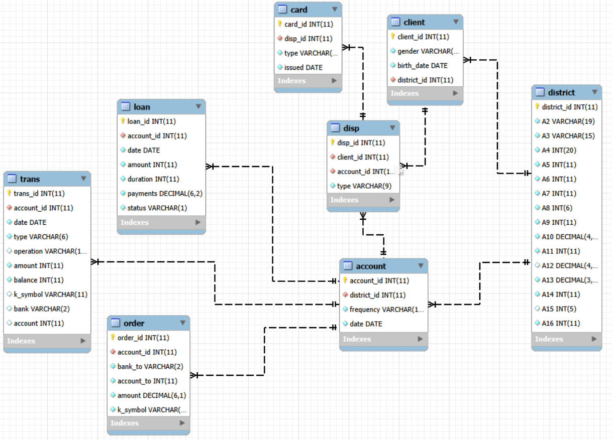
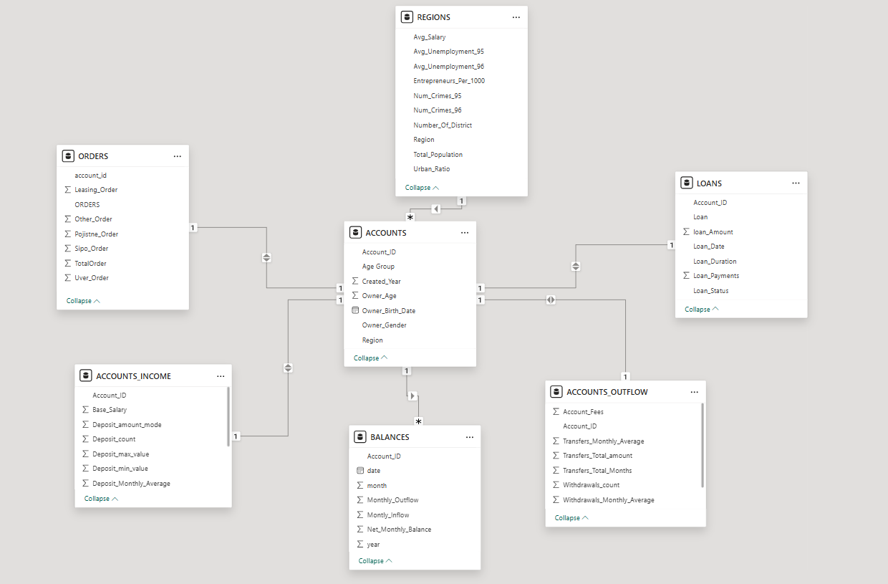
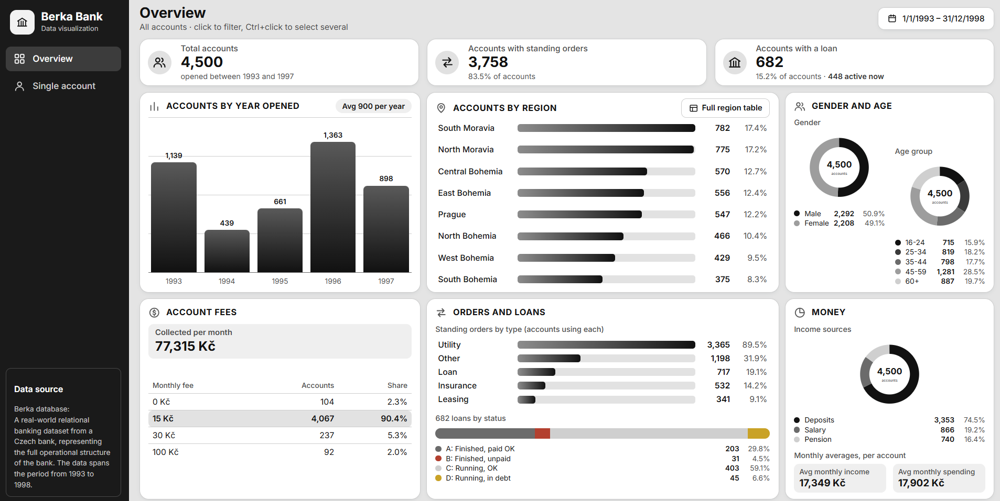
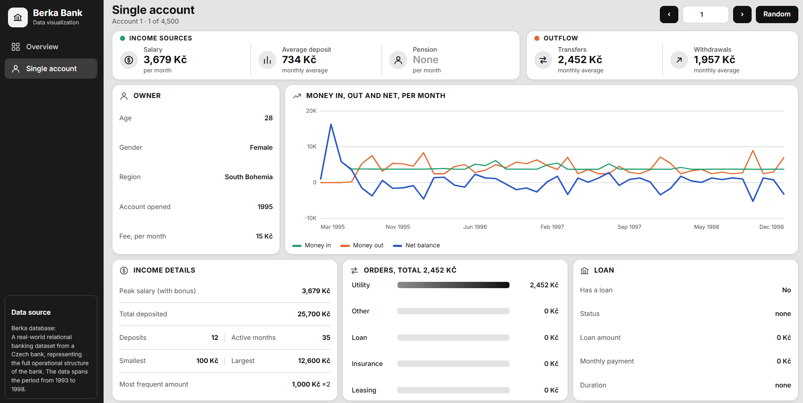
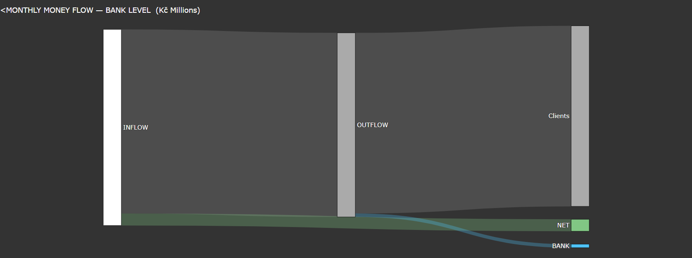

# Berka Database · Part 1: Exploring

This project explores the Berka database, a real-world relational banking dataset from a Czech bank. It covers the full operational structure of the bank from 1993 to 1998 with 4,500 accounts and 1.06 million transactions across eight tables.

This project delivers two things:

• An interactive visualization to explore the bank by region, age, year, fees, orders, loans and income.

• A bank-level money-flow visualization showing the monthly average flow of money.

 [**Interactive visualization**](https://aliabedalkereem-byte.github.io/Data-Analytics-Portfolio/)
 
[**Money Flow**](https://colab.research.google.com/github/aliabedalkereem-byte/Data-Analytics-Portfolio/blob/main/1.Berka_Database_Exploring/money_flow.ipynb) 
[](https://colab.research.google.com/github/aliabedalkereem-byte/Data-Analytics-Portfolio/blob/main/1.Berka_Database_Exploring/money_flow.ipynb) 

[SQL_Scripts](SQL_Scripts.sql)  ·  [Extracted Data](Data)  ·  [Full Report](Project_Report.pdf)       


---

## Key findings
- **Engaged clients:** 84% of accounts have standing orders, mostly utility payments.
- **Few loans:** only 15% of accounts have a loan, and 89% of those are in good standing.
- **Money passes through:** in an average month, 44.8M Kč comes in and 42.1M Kč goes out. About 6% stays.
- **The bank keeps little directly:** 98% of outflow is client activity; fees are only 38K Kč a month.
- **Regions:** South and North Moravia hold the most accounts (35%) but have the fewest per 1,000 residents. Prague has the highest salary and lowest unemployment, with 12% of accounts.

---

## 1 · Data 
Data was extracted with SQL from a public MySQL server (Czech Technical University, Prague) into clean CSV tables.

Database structure:



Extracted Data Structure:




## 2 · Interactive Visualization
Two pages built on one master table with one row per account using Plain HTML, CSS and JavaScript: click → [`Data_Visualization/`](https://aliabedalkereem-byte.github.io/Data-Analytics-Portfolio/)






## 3 · Bank-level money flow
The full transaction history, standardised to an average month (Python, pandas, Plotly).



---

## Repository
```
data/                 source CSV tables
Data_Visualization/    (open index.html)
images/               screenshots and diagrams
money_flow.ipynb      money-flow notebook
SQL_Scripts.sql       extraction and preparation
Project_Report.pdf    full report
```

**Tools:** MySQL · SQL · Python (pandas, Plotly) · Google Colab · JavaScript · Html · CSS · GitHub Pages

